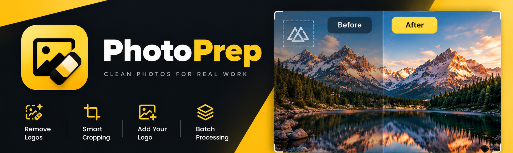

# PhotoPrep

[English](README.md)

PhotoPrep готовит фотографии локально на Mac: Ретушь → Кадрирование → Логотип →
Пакетный экспорт. Исходники не меняются, фотографии не отправляются для обработки.

## PhotoPrep Native — основное направление развития

Будущее приложение для macOS будет работать на **SwiftUI + Core ML**. Для него
выделены [отдельная папка](apps/native/README.md) и подробная
[дорожная карта миграции](apps/native/ROADMAP.md). Нативная реализация в этом
репозитории ещё не начата; готового нативного приложения для скачивания пока нет.
Python v0.2.0 остаётся рабочим приложением и образцом поведения на время миграции.

## Доступно сейчас: PhotoPrep Python v0.2.0

**[Скачать DMG для Apple Silicon и SHA256](https://github.com/sirdimitry/PhotoPrep/releases/tag/v0.2.0)**

Требуется macOS 14+. Python включён в приложение. Подпись ad-hoc, нотариализации
Apple нет. Intel и другие версии macOS не проверены.

Сохранены LaMa, MI-GAN, опциональный SDXL, накопительная ретушь, кадрирование,
локальные PNG-логотипы, пакетный экспорт JPEG/PNG, RU/EN и светлая/тёмная темы.
Читаются форматы наборов 1–7. Версия v0.2.0 выпускает работоспособную alpha.18;
нового формата наборов и нативного движка в этом выпуске нет.

[Руководство Python-версии](apps/python/README.ru.md) ·
[Разработка и сборка](DEVELOPMENT.md) · [История версий](CHANGELOG.md)

## Структура репозитория

| Папка | Назначение | Состояние |
| --- | --- | --- |
| [`apps/native/`](apps/native/README.md) | Основное будущее приложение SwiftUI/Core ML | Дорожная карта |
| [`apps/python/`](apps/python/README.ru.md) | Рабочая Python/PySide6 версия, тесты, ресурсы, сборка | v0.2.0 |
| [DEVELOPMENT.md](DEVELOPMENT.md) | Проверки, сборка и выпуск | Оба направления |
| [CHANGELOG.md](CHANGELOG.md) | История выпусков | Прежние записи сохранены |

Обе версии живут рядом в одном репозитории. Миграция должна сохранить исходники
Python, опубликованные выпуски и совместимость наборов. Будущая нативная сборка
получит отдельные имя приложения, bundle identifier и имя файла дистрибутива,
чтобы версии устанавливались одновременно и случайно не делили настройки.

[Лицензия MIT](LICENSE) · [Сторонние компоненты](THIRD_PARTY_NOTICES.md)
